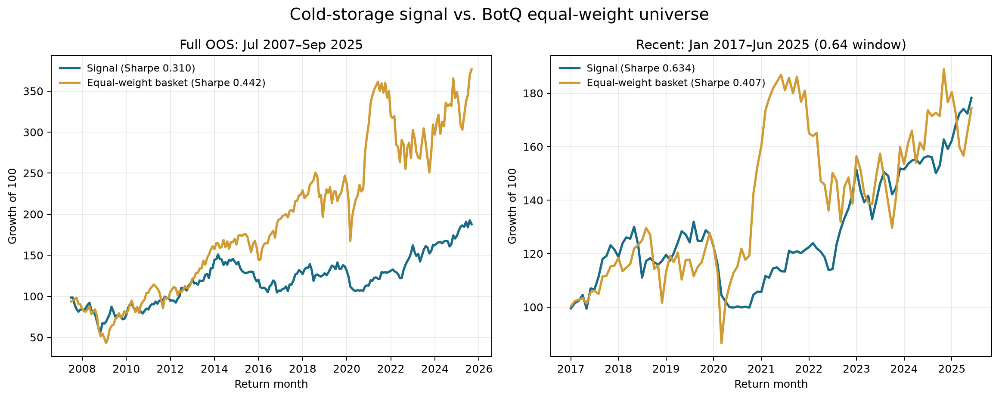
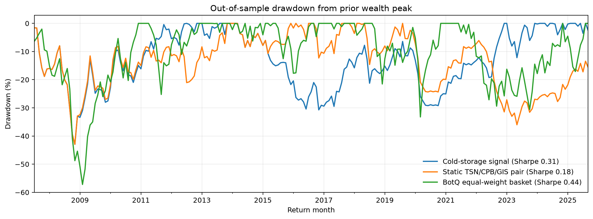
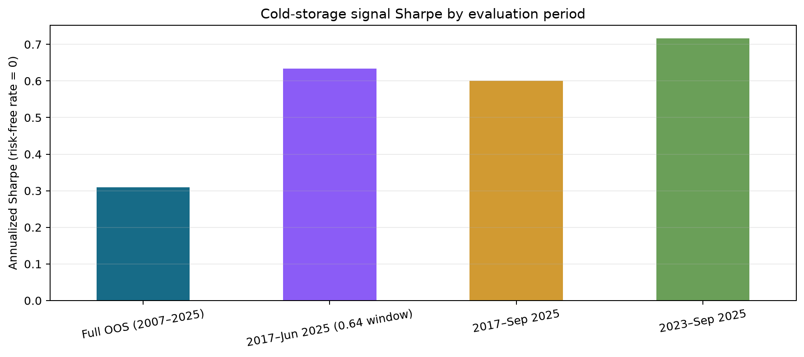

# Battle of the Quants: Beef Cold-Storage Signal

A quantitative research project testing whether changes in USDA beef cold-storage inventory contain information about Tyson Foods' future returns relative to a packaged-food peer basket.

## Strategy

The signal uses the year-over-year change in monthly beef cold-storage inventory. An expanding, one-feature OLS model forecasts Tyson Foods (TSN) relative to an equal-weight Campbell's (CPB) and General Mills (GIS) basket two months ahead. A dollar-neutral long-short portfolio takes the forecast direction and reverses the position when the forecast is negative.

The notebook documents the data preparation, walk-forward timing, backtest, comparison portfolio, transaction-cost sensitivity, and key limitations.

## Results

| Evaluation window | Annualized return | Annualized volatility | Sharpe ratio | Maximum drawdown |
| --- | ---: | ---: | ---: | ---: |
| July 2007-December 2025 | 4.0% | 14.5% | 0.341 | -42.9% |
| January 2017-June 2025 (exploratory) | 7.0% | 11.9% | 0.634 | -24.4% |
| January 2017-December 2025 (exploratory) | 7.5% | 11.9% | 0.668 | -24.4% |

The recent-period result is a development subperiod, not an untouched holdout. The two-month horizon was selected after testing alternatives, which creates selection bias. Reported strategy returns are gross of transaction costs, short-borrow fees, financing, taxes, and market impact.

## Visual results

The matched BotQ universe charts below end in September 2025 (and the recent matched window ends in June 2025). The full-year December 2025 signal extension appears in the results table above; the BotQ universe comparison is not extended beyond September because those source observations are unavailable.







## Repository contents

- `beef_cold_storage_signal.ipynb` - executed research notebook and charts.
- `scripts/prepare_botq_monthly_returns.py` - converts an authorized daily BotQ export into a compact monthly panel.
- `results/` - aggregate charts; time-series CSV exports are omitted.
- `requirements.txt` - Python dependencies.
- `data/README.md` - expected local data files and redistribution note.

## Reproduce the analysis

1. Create an environment and install the listed packages:

   ```bash
   python -m pip install -r requirements.txt
   ```

2. Obtain the required source series from authorized sources and place the input files in `data/`. The competition-derived stock panel is intentionally excluded; use it only if your BotQ access terms allow local use.
3. Open `beef_cold_storage_signal.ipynb` and run the cells in order.

The BotQ preprocessing script accepts a `.parquet`-named competition export that contains CSV text. It compounds daily return values (in percentage points), keeps stock-months with at least 15 valid observations, and removes the incomplete last month.

## Data and backtest limitations

- The USDA history is revised data rather than archived point-in-time vintages, and the assumed one-month publication lag was not checked against each release date.
- The two-month horizon and recent-period window were explored during development; neither is an untouched holdout.
- The equal-weight BotQ universe is a Russell-universe proxy, not the official market-cap-weighted Russell 3000 index.
- The long-short portfolio is dollar-neutral, but it is not guaranteed to be market-beta-neutral. Packaged-food peers are imperfect controls for Tyson.
- The December 2025 extension uses public adjusted prices for TSN, CPB, and GIS. The BotQ universe comparison ends in September 2025 because its source export has no later observations.

## Sources

- [USDA ERS Livestock and Meat Domestic Data](https://www.ers.usda.gov/data-products/livestock-and-meat-domestic-data/)
- [USDA ERS data documentation](https://www.ers.usda.gov/data-products/livestock-and-meat-domestic-data/documentation/)
- [Tyson Foods historical data](https://finance.yahoo.com/quote/TSN/history/)
- [Campbell's historical data](https://finance.yahoo.com/quote/CPB/history/)
- [General Mills historical data](https://finance.yahoo.com/quote/GIS/history/)
